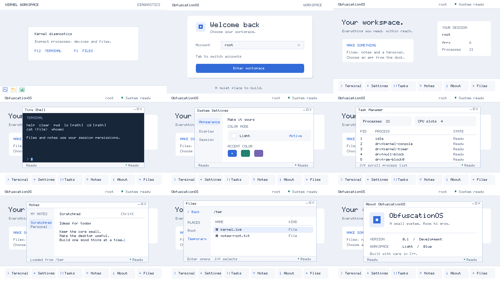

# Workspace GUI

The compositor uses a 480 x 270 logical framebuffer, displayed at 960 x 540. Kernel
`ok/gui/theme.hpp` defines the shared light, cool-gray and blue tokens;
`ok/gui/paint.hpp` supplies bounded drawing helpers. These are exported SDK headers.
The Kernel owns window chrome and its diagnostics workspace. ObfuscationOS owns the
login screen, desktop, launchers and application content.

The desktop supports Terminal, Settings, Tasks, Notes, Files and About:

- Terminal accepts `help`, `clear`, `pwd`, `ls`, `cd`, `cat` and `whoami`.
- Settings changes the accent used by the active session's application windows.
- Tasks reads the scheduler and CPU topology; J/K scrolls the process list.
- Notes accepts text, Enter and Backspace; Ctrl+S saves a private file in `/tmp`.
  Root and user have separate notes. Reopening Notes reloads the saved file.
- Files navigates directories, previews text, and supports J/K, Enter and Back/Escape.

File operations enforce the selected session's POSIX permissions. Notes use
`/tmp/notes-root.txt` or `/tmp/notes-user.txt` with mode 0600; this is temporary storage,
not persistent storage across reboot. Text uses the existing ASCII bitmap font.

These application views are currently rendered and handled by the prelinked OS
extension in kernel service context. Session credential binding does not alter
an unrelated scheduled process. Their process records and ELF validation do not
mean their GUI code executes in an isolated user address space. The Terminal
window runs a bounded command handler; it is separate from the native `oksh`
console program. Native user execution through `/init` is a separate runtime path.
The native `notes` command defaults to `/tmp/notes.txt`; pass a GUI note's path
explicitly to access the same document.

## Reproduce screenshots

Export an up-to-date x86_64 debug Kernel SDK with the GUI enabled. Then run from the
ObfuscationOS root:

```sh
python3 tests/gui/render_workspace.py --sdk /absolute/path/to/exported/sdk --out /tmp/gui-render
```

The script validates the SDK manifest and checksums, compiles only OS sources against
its headers/archive, exercises the real renderer and input path, verifies note
persistence, and exports nine PPM and PNG frames. The PNGs use exact 2x nearest-neighbor
scaling. It does not execute the native privileged backend.

The OS integration suite also checks login, repeated startup, app lifetime, dock
focus, private note persistence, file navigation and diagnostic-window recovery.
Keep hosted model checks separate from QEMU hardware and native user-program tests.

## Visual QA

The checked-in screenshots were produced by the hosted fixture, using the production
compositor and OS modules. Two visual review rounds checked all nine screens. The
reviews caught and fixed a keyboard-login resize event swallowing the first dock
click, and paragraph rendering skipping the first character after a blank line.
Further checks verified text contrast, clipping, the note caret, the shared window
chrome, launcher labels and the saved-file result.



The native `oksh` currently uses the serial console. Desktop keyboard input is
routed only to GUI views; text entered in Notes is never also sent to that shell.
The desktop Terminal remains the OS extension command view described above.

## QEMU framebuffer check

The hosted overview is complemented by an actual QEMU framebuffer/input check:

```sh
python3 tests/gui/capture_qemu.py --arch x86_64 --qemu /usr/bin/qemu-system-x86_64 \
  --kernel build/x86_64/release/distro/kernel.bin \
  --rootfs build/x86_64/release/rootfs.simplefs.img --out build/qemu-gui
```

This uses QMP over stdio, saves the guest login/desktop frames, and types `hello`
into the greeter to verify that GUI keystrokes cannot execute that command in the
background serial shell. Raw boot/test logs stay on serial after the compositor
starts; they do not overwrite the login card. The session card lists applications;
the Tasks CPU-slot metric is scheduler topology capacity, not evidence of AP startup.
