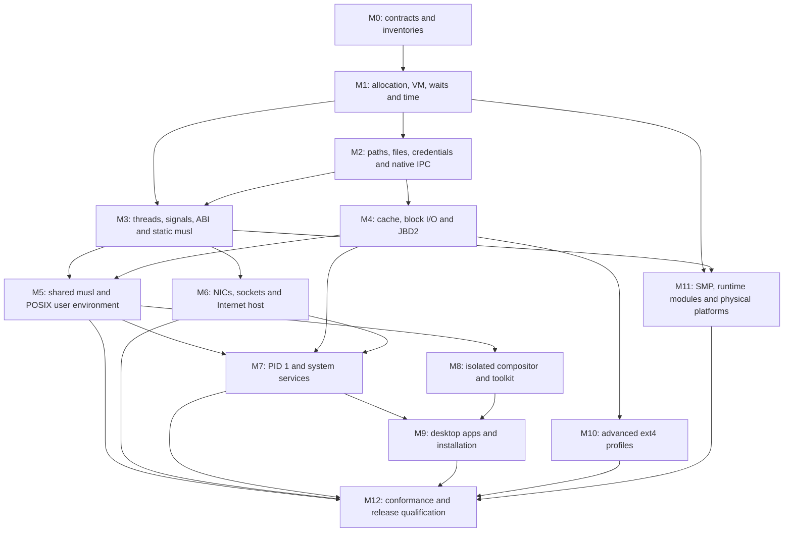

# Complete workstation implementation plan

Status: proposed design and implementation backlog, **not implemented support**.
The generated [capability matrix](STATUS.md) is the single per-requirement status
table; regenerate it from the ledger instead of editing it. The worktree-level
execution plan is [PLAN.md](../PLAN.md).
The generated [capability matrix](STATUS.md) is the single per-requirement status
table; regenerate it from the ledger instead of editing it. The worktree-level
execution plan is [PLAN.md](../PLAN.md).
Implementation has started; [progress and evidence](IMPLEMENTATION_PROGRESS.md)
record completed slices and remaining gates separately from this target design.
The [milestone status review](MILESTONE_STATUS.md) compares current behavior with
the M0-M12 exit gates without assigning unsupported completion percentages.
Baseline reviewed on 2026-09-20: ObfuscationKernel `c15dee2`, ObfuscationOS
`7bff2e9`. This plan supersedes earlier next-step lists for the long-term target;
the existing documentation remains the description of current behavior.

## 1. Outcome and navigation

Deliver a general-purpose, multi-user workstation that boots from recoverable
ext4 storage, starts supervised services, offers an accessible graphical login
and desktop, runs musl-linked applications, implements the selected POSIX
standard, and interoperates with ordinary IPv4/IPv6 networks. Preserve all ten
architecture profiles throughout development. A smaller implementation milestone
must never be presented as this complete outcome.

The implementation is divided into these specifications:

| Specification | Decisions and implementation detail |
| --- | --- |
| [Architecture, SDK and modules](ARCHITECTURE_SDK.md) | Ownership, static dispatch, resources, cross-architecture execution, module loading, SDK and third-party ports |
| [POSIX and musl](POSIX_MUSL.md) | VM, process/thread semantics, pathname operations, ABI, libc, dynamic linking, shell/utilities and conformance |
| [Storage and ext4](STORAGE_EXT4.md) | VFS, cache, async block I/O, full feature inventory, JBD2, durability, recovery and interoperability |
| [Networking and services](NETWORK_SERVICES.md) | NICs, socket API, Internet protocols, supervision, system daemons and secure sessions |
| [Desktop and applications](DESKTOP_APPS.md) | User compositor, display/input ownership, protocols, toolkit, visual design and usable system apps |

These documents specify intended objects, responsibilities, lifetimes,
synchronization, failure handling and acceptance tests. New names and paths are
proposals, not APIs already exported by the SDK. Before each implementation
change, turn its work item into a small reviewed interface/state-machine design;
do not freeze thousands of speculative declarations before exercising a vertical
slice.

## 2. Baseline and actual gaps

| Area | Evidence in current tree | Gap to the requested target |
| --- | --- | --- |
| Architecture and SDK | Ten native ELF profiles; explicit architecture/mode/compiler/hash SDK validation | General allocation/VM, concurrency, full per-architecture user ABI and sustained workloads |
| Processes | Native privilege transition, fork/exec/wait, preemption, fault containment and pipes | Threads, signals, timers, TTY/job control, unrestricted workloads and complete resource accounting |
| Files | RAM/ext4 nodes, cwd/dirfd identity, rename/link, scalar/vectored I/O and sync | Unified resolver, symlinks, file/page cache, mounts, locks, advanced metadata and full POSIX behavior |
| ext4 | Real Virtio root on all ten QEMU profiles; non-journalled bounded mutation | Recovery, journal transactions, modern feature bits, unbounded trees and full interoperability |
| Network | Loopback/debug protocol and service models | Real NIC-to-user socket path, robust TCP/IPv6, configuration and interoperable services |
| Daemons | `/init` launches native acceptance/shell; module/service lifecycle models | Persistent userspace PID 1, readiness, privilege separation, reaping, shutdown and installed services |
| GUI | Light desktop and app views in the prelinked OS kernel extension | Isolated compositor/apps, actual shared mappings, scalable text/input, accessibility and real app workflows |
| libc | Small native C runtime and common syscall numbering | Qualified musl architecture ABI, complete kernel semantics, pthreads, loader, locale and package ecosystem |

Sources: [Kernel roadmap](../../../ObfuscationKernel/docs/ROADMAP.md),
[native execution](../../../ObfuscationKernel/docs/NATIVE_EXECUTION.md),
[OS README](../../README.md), [GUI](../GUI.md), [storage](../STORAGE.md),
[`/init`](../../apps/init/main.c). A test executed inside QEMU may still test a
model; record which instructions, syscalls and device transactions actually ran.

The old fixed pools are useful deterministic bootstrap fixtures. They are not
the intended limits of a workstation. Existing tests should migrate with the
implementation, with explicit model labels where applicable.

## 3. Meaning of complete

### 3.1 POSIX and musl

- Target **IEEE Std 1003.1-2024 / POSIX.1-2024, Issue 8**, including Base
  Definitions, System Interfaces, Shell and Utilities. Keep a separate
  compatibility lane for widespread POSIX.1-2008/2017 applications.
- Mandatory requirements are release gates. Inventory optional/XSI/realtime
  options individually, implement the workstation profile specified in the
  POSIX design, and publish unsupported options accurately through headers,
  `sysconf`, `pathconf` and `getconf`. Never use an optional label to hide a
  mandatory failure. Record non-applicable hardware features with reasons.
- API symbols, syscall stubs and passing a handful of LTP tests are insufficient.
  Required semantics include races, signals, cancellation, limits, permissions,
  locale, errors, restart behavior and shell behavior. Formal certification is
  an additional project; do not claim certification from internal tests.
- Port a pinned, unmodified-as-far-as-possible musl release, including static and
  shared libc, its dynamic loader, TLS, pthreads, cancellation, resolver, stdio,
  math and public headers. An architecture absent from that release requires a
  maintained port; no architecture disappears from the matrix as a workaround.
- musl targets Linux ABI behavior and has deliberate implementation choices;
  its use alone proves neither complete Linux compatibility nor Issue 8
  conformance. Track required OS/musl patches and standards gaps separately.

### 3.2 ext4

Pin Linux ext4 format documentation, kernel reference version and e2fsprogs
version in the first implementation milestone. Maintain a per-feature matrix of
read, write, recovery and tooling support. Reach ordinary modern ext4 read/write
interoperability first, then every claimed optional format profile in the storage
plan, including checksums, journalling, indexes, 64-bit addressing and advanced
features. Encryption, verity, quota, casefold, bigalloc and fast commit are
explicit work, not implied by a successful basic file test.

Until that inventory and supported combinations pass, label the result
**ext4 subset** or **modern ext4 profile**, not full ext4. A filesystem carrying
unknown incompatible features must fail safely; read-only fallback is allowed
only when the on-disk feature rules actually permit it. Do not promise support
for features added by future upstream versions without a new qualification.

### 3.3 Networking

Complete Internet-host support means Ethernet/loopback, ARP, IPv4/IPv6, ICMPv4/v6,
neighbor discovery, UDP, TCP, routing, multicast membership, fragmentation/PMTU,
reliable socket and event APIs, configuration, DNS, time and secure remote tools.
Test host interoperability, packet loss/reordering, pressure and hostile packets.
Routing appliance functionality, Wi-Fi management, IPsec, Bluetooth and advanced
offloads have their own explicit extension gates; they cannot be represented as
already supplied by this host stack. Required capabilities for a chosen physical
workstation, such as Wi-Fi, must enter its release hardware profile.

### 3.4 Services and desktop

An unattended boot must reach a real graphical greeter; login creates an
unprivileged session. An application crash must leave the desktop and stored
data usable. Users can manage files, edit and save documents, use a terminal,
configure networking/display/input/accounts, inspect tasks/logs, install trusted
packages, lock/logout and safely shut down. Recovery must be usable when the
desktop, disk or network fails. Ordinary operation must not require a serial
console or knowledge of SDK/module details.

The target includes keyboard-only use, UTF-8/CJK text and input, scaling,
accessibility interfaces, usable empty/error/loading states and persistent user
preferences. A collection of attractive static windows does not satisfy it.

## 4. Binding architecture decisions

1. Kernel mechanisms remain in ObfuscationKernel; desktop, distribution policy,
   external NIC/block/display drivers, modules, Linux driver adaptation and
   application packages remain in ObfuscationOS.
2. Introduce an explicit **Linux userspace syscall personality** per architecture
   to make musl maintainable. Keep the existing native personality during
   migration. Share typed kernel operations behind the adapters; do not duplicate
   VFS/process/network implementations. This does not require a Linux kernel or
   imply arbitrary Linux binary/driver compatibility.
3. Establish allocation, VM, blocking/wakeup, time, reference lifetimes and
   lock ordering before building features that depend on them. Replace model
   synchronization with executed behavior. Test SMP before claiming concurrent
   kernel safety; retain functioning uniprocessor paths.
4. Use templates/concepts for architecture, page-table, scheduler and measured
   packet/render hot algorithms. Use OOP at actual runtime device/filesystem or
   module boundaries; userspace IPC uses serialized versioned messages, never
   cross-process C++ object pointers.
5. Implement a userspace Wayland compositor and software rendering first;
   retain the basic Kernel GUI as boot/rescue diagnostics. Keep full desktop
   policy out of that rescue path. Acceleration is a subsequent driver/backend,
   not a dependency for the first isolated desktop.
6. Reuse musl, upstream filesystem maintenance tools, font shaping, protocol
   libraries, a mature shell and selected applications. Build native kernel
   mechanisms deliberately. Use xmake to orchestrate pinned third-party builds
   and sysroot packaging; upstream build recipes may run inside those tasks.
7. Check C++ module compiler/layout compatibility strictly. Stable userspace ABI,
   versioned C service records and same-SDK native C++ ABI are different
   contracts. No stable binary promise crosses arbitrary C++ compiler versions.
8. Data integrity, permission checks and bounded resource consumption are
   feature semantics, not a final hardening pass.

## 5. Dependency graph



The numbering is an integration order, not an instruction to delay tests or all
parallel work. Storage, networking and compositor work can branch once their
foundations are demonstrably stable. M11 starts early; production kernel changes
must use its locking and lifetime rules from M1, not add concurrency afterward.
Additional optional POSIX requirements continue through M12, which cannot waive
unfinished mandatory items.

## 6. Milestones and executable exit gates

| Milestone | Concrete deliverable | Exit gate |
| --- | --- | --- |
| M0: specification baseline | Standards/format/RFC inventories, syscall/ELF ABI matrix, SDK generations, feature ledger, dependency pins | Every requirement has owner, semantics source, dependencies and a planned test; ten ABI profiles have explicit qualification gaps |
| M1: resource foundation | Kernel-owned allocators, general native VM, safe user copies, wait queues, timers, locking/atomics, FPU context | Ten native guests run allocation/map/unmap/protection/pressure/timer tests without corrupting kernel or peers; document real hardware restrictions |
| M2: common OS objects | Unified path resolution, symlinks, inode/dentry/mount references, file descriptions, credentials, AF_UNIX/descriptor passing, TTY | Relative exec works from a renamed cwd; open/unlink/rename races preserve identity; PTY child and IPC peers terminate/wake correctly |
| M3: libc substrate | Per-arch Linux ABI adapter, threads/TLS/futex/signals, auxv and static musl | Each architecture executes musl-linked file/process/thread/signal/clock tests; 32-bit time64/off64 and endian layouts pass golden vectors |
| M4: durable default root | Canonical metadata buffers, block request/completion ownership, synchronous JBD2 replay/writer and modern ext4 core | Linux-created image boots, mutates, power-fails, replays, and passes Linux/e2fsck checks; fsync claims tested through actual FLUSH ordering |
| M5: useful POSIX userland | Shared musl/loader, coherent file mappings/page cache, shell/job control/utilities, remaining file/time/IPC/locale semantics and ports framework | Shared applications, dlopen/TLS, pthread cancellation, shell pipelines/redirection/jobs and designated POSIX suites execute in guests |
| M6: connected host | IRQ-driven Virtio NICs, sockets/events, IPv4/IPv6 UDP/TCP and route configuration | Guest-to-host and guest-to-guest applications run over actual NICs under loss/reordering; DNS and HTTP/TLS clients work without debug transport |
| M7: managed system | User PID 1, accounts, login/session, device, network, resolver, logging, time, mount and scheduler services | Boot without test mode, crash/restart services, recover dependency failure, reap orphans, rotate logs and shut down/reboot with disk consistency |
| M8: isolated graphics | Display/input descriptors, seat leases, Wayland, shared buffers, fonts, toolkit and PTY terminal | Separate user compositor and two clients draw concurrently; killing one client cannot read peer buffers or stop input; kernel rescue survives |
| M9: daily desktop | Files, editor, settings, tasks, logs, network, packages, installer/recovery and accessibility | Scripted and human novice workflows pass: login, network, file copy/save/reopen, package install/rollback, lock and clean shutdown |
| M10: ext4 breadth | Advanced features and qualified combinations from the ext4 matrix | Every advertised read/write/replay profile round-trips with pinned Linux/e2fsprogs; unsupported combinations are explicitly rejected |
| M11: execution breadth | Real SMP and TLB shootdowns, loaded native modules, IRQ/DMA/hotplug, physical reference machines | Module code truly relocates/executes; no use-after-unload; concurrent filesystem/socket/GUI stress passes; hardware evidence is separate from QEMU |
| M12: full target | Closed requirements ledger, release/debug qualification, reproducible artifacts, documentation and recovery media | No mandatory or selected-profile gaps; ten architectures pass the applicable user ABI/product gates; scope and remaining outside-profile limitations are published |

M4 corresponds to storage S1-S5 correctness gates. The file-mapping/cache
coherence part of S6 is required for M5; IRQ-driven writeback, multiqueue and
SMP optimization continue through M11. A synchronous journal is a valid early
durability milestone, not a claim of completed asynchronous storage. Waived
mandatory failures permit only an explicitly incomplete preview, never M12.

Do not remove a profile from the release table when a port lags. Show it as
incomplete and hold the all-ten completion claim. A preview can ship earlier
with an explicit capability table. Physical machine selection is a separate
support matrix; QEMU success does not assert support for every board or PC.

## 7. First implementation batches

These are the next bounded changes, not authorization to implement the entire
program in a documentation task. Each batch should be reviewable and leave both
repositories bootable against a newly validated SDK when its boundary changes.

Execution preference confirmed on 2026-09-20: once implementation is requested,
continue through multiple dependent milestones without a routine approval stop
at every milestone. Preserve separate changesets, verification and progress
reports. Resolve ordinary design details within these constraints; report a
material scope change or external blocker explicitly. A failed gate is work to
fix before dependent work proceeds, not a pass because the next stage is ready.

1. **Contract and evidence ledger.** Pin the standards/tool versions, record
   current native vs model capability per architecture, decide exact Linux ABI
   triples and add requirement/test manifest schemas. Explicitly revise the
   Kernel no-heap rule before introducing controlled kernel allocation.
2. **One pathname resolver.** Add object-based starting directory/root, symlink
   traversal, component search permissions and final-component policies; migrate
   all calls, including cwd-relative `execve`, without losing cwd/dirfd/mount
   identity. Add rename/unlink/mount/permission race regression cases.
3. **Allocation and VM substrate.** Make the physical allocator own the real RAM
   map; add kernel object allocation, page ownership, native mapping, range
   validation and fault recovery. Keep eager fork until COW is validated.
4. **Blocking substrate.** Unify wait registration, condition checks, wakeup and
   timeout/cancellation; implement calibrated clocks and native poll/select on
   files/pipes/TTY before adding sockets. Use architecture atomic/IRQ contracts.
5. **Musl executable spike.** Pin a release and build ten sysroots; run a minimal
   static musl program through the proposed personality on representative 64-bit,
   32-bit and big-endian guests. Failed probes are port requirements, not
   permission to drop those architectures. Extend to the full matrix before
   accepting the ABI milestone.
6. **Durability spike.** Build an offline journal parser/replayer and fixture
   corpus before enabling a journalled writer. Verify endian/checksum/revoke/
   wraparound rules independently, then exercise replay in a booted guest.

After these batches, detailed work IDs in the subsystem documents divide into
three useful parallel streams: POSIX/libc, storage/recovery, and devices/network.
User service and graphics integration follows usable process/IPC/libc contracts.
This avoids building a second GUI around temporary privileged APIs.

## 8. Requirement and evidence ledger

Create versioned machine-readable manifests during M0, with this minimum schema:

```text
id, subsystem, source_version, source_section, requirement_level,
owner_repository, dependencies, architecture, feature_profile,
implementation_paths, state, native_test_ids, model_test_ids,
interop_test_ids, fault_test_ids, limitations, evidence_artifact_hash
```

Allowed states: `planned`, `model-only`, `native-partial`, `implemented`,
`verified`, `not-applicable-with-rationale`. A waived test is not `verified`.
Record unsupported standards options separately from ordinary implementation
bugs. Generate the public capability matrix and `_POSIX_*` policy checks from
this ledger so documentation, headers and runtime detection cannot drift.

Evidence layers:

1. Hosted model/unit tests: data structures, parser fixtures and algorithms,
   with sanitizers/fuzzing where possible.
2. Standalone Kernel: boot, hardware traps/page mappings, interrupt/wakeup and
   device paths, without OS policy dependencies.
3. OS SDK consumer: manifest/hash/compiler mismatch rejection, image linkage,
   package/rootfs generation and native userspace integration.
4. QEMU integration: debug and release, all ten profiles, actual ELF processes,
   DMA/IRQ, two-machine network tests, reboot and destructive scratch-disk tests.
5. External interoperability: Linux/e2fsprogs, independent TCP endpoints,
   Wayland clients and public POSIX/libc suites. Tests classify expected Linux
   extensions separately from POSIX requirements.
6. Physical platform qualification: at least named reference machines covering
   coherent/noncoherent DMA, SMP, storage flush and real display/input. Never
   infer physical results from emulator counters.

CI should use fast representative profiles on each change and the complete
matrix before merging architecture-sensitive changes and before a milestone.
Include a 32-bit and a big-endian profile in the fast lane. Cross-endian fixtures
are necessary even for little-endian on-disk/network formats. Failure injection,
resource exhaustion and negative privilege tests are first-class gates.

## 9. Quality budgets and observability

Initial target budgets must be measured and revised against named hardware;
they are engineering goals, not current performance claims:

- Desktop reference configuration: 1280x720, 1 GiB RAM, two virtual CPUs and a
  software renderer. Keep the ten-profile headless/minimal configuration too.
- Aim for 60 Hz composition under normal interaction (16.7 ms frame budget),
  input-to-present p95 below 50 ms, and no active polling when the desktop is
  idle. Record QEMU results separately from physical GPU results.
- Report boot-to-greeter p50/p95, idle RSS/CPU, peak allocation, file throughput
  and fsync p50/p99, scheduler wakeup latency and TCP throughput/retransmissions.
  Set pass/fail thresholds only after stable baselines; never optimize away
  required flush, permission or bounds checks to meet a benchmark.
- Expose monotonic counters and bounded trace rings for allocator pressure,
  faults, waits, IRQs, I/O, journal commits, socket drops and presentation. Export
  sanitized snapshots through device/proc interfaces, with access checks.
- Every blocking operation has a wake condition, cancellation rule, resource
  owner and documented behavior on peer death/device removal. Every persistent
  operation has an explicitly tested durability boundary.

## 10. Major risks and decision gates

| Risk | Resolution before expanding scope |
| --- | --- |
| Current pools and model primitives appear production-ready | Native allocation/VM/wait tests and bounded memory accounting precede library/desktop growth |
| musl mismatches custom syscalls or a rare ABI | Pin version, qualify all architecture ABIs, keep thin adapters and upstream-focused patches |
| Broad POSIX claims mask missing utilities/locale/optional semantics | Standards inventory, a named profile, native tests and explicit conformance labels |
| ext4 journal implementation corrupts data under interruption | Independent replay fixtures, transaction invariants, write-cut tests, Linux round-trip and offline recovery tooling |
| Driver API models conceal DMA/IRQ/SMP bugs | Real interrupt completion, cache maintenance, reset/hot-unplug and concurrent native tests |
| Native GUI protocol becomes a second incompatible ecosystem | Wayland clients/server with minimal OS display/input UAPI; reuse established text/rendering libraries |
| A compromised app receives desktop-wide privilege | Unprivileged clients, seat/display leases, peer-credential IPC, brokered file/device actions and trusted lock surface |
| Runtime C++ modules mix toolchains or unload live code | Exact SDK contract, dependency/refcount lifetime rules, quiescence and unload refusal |
| Ten profiles multiply integration cost | Shared mechanisms/templates, generated ABI manifests, mandatory representative tests plus full release matrix |
| Optional projects prevent a usable release | Ship clearly named preview profiles while maintaining the full target ledger and its completion gates |

Do not attach an arbitrary calendar estimate to this program. Estimate each
milestone after its executable spike, based on known port gaps, test failures and
available contributors. The critical path is resource/ABI correctness, musl and
durable storage, followed by real service/GUI integration; repainting the current
kernel-mode desktop cannot shorten that path.
